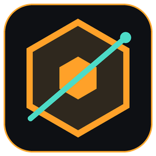

# SC Companion

**Une app compagnon pour Star Citizen, centrée sur le crafting.** Windows · français / English · gratuit
Codée et entretenue par **Viperhill**.

👉 **[Télécharger la dernière version](https://github.com/viperhill1/SCCompanion/releases/latest)**

---

## Ce qu'elle fait

- **Crafting** : choisis un plan, règle les qualités visées, et l'app te dit exactement quels matériaux il te manque, et quelles missions donnent ce plan.
- **File de craft** : tes projets groupés par vaisseau ou par setup, avec la liste de courses des matériaux.
- **Route de minage** : le moins d'arrêts possible pour aller chercher ce qui manque, avec la vraie chance de trouver chaque minerai et les signatures à repérer au scanner.
- **Vaisseaux** : un configurateur (composants, qualités de fabrication, gestion d'énergie par pastilles, DPS soutenu, bouclier, signatures, portée quantique). Envoie ton setup au crafting en un clic.
- **Panier** : ce qui ne se fabrique pas, et où l'acheter (prix de la communauté UEX, itinéraire, total).
- **Inventaire** : à la main ou par captures d'écran du gestionnaire de fret. Tes plans possédés sont cochés tout seuls en lisant le `Game.log`.

Les données sont lues **directement dans les fichiers du jeu installé** : l'app est à jour à chaque patch, et elle ne modifie jamais le jeu.

## Installer

1. Télécharge `SCCompanion-vX.XX.zip` dans les [Releases](https://github.com/viperhill1/SCCompanion/releases).
2. Fais « Extraire tout » où tu veux (Bureau, `C:\Jeux`…). Évite `Program Files` : l'app garde tes données à côté d'elle, dans `data`.
3. Lance `SCCompanion.exe`, puis clique **METTRE À JOUR** en haut à droite. Refais-le après chaque patch du jeu.

Le guide complet est dans l'app : bouton **?** ou touche **F1**. L'app démarre en anglais : passe-la en français avec le bouton **⚙**.

## Mettre à jour

**Nouvelle version de l'app**
1. Ferme SC Companion.
2. Télécharge le nouveau `SCCompanion-vX.XX.zip` dans les [Releases](https://github.com/viperhill1/SCCompanion/releases) et fais « Extraire tout » dans un dossier temporaire.
3. Copie tous les fichiers extraits dans ton dossier SCCompanion actuel et choisis « Remplacer les fichiers dans la destination ».
4. Lance `SCCompanion.exe` : la nouvelle version s'affiche en haut à gauche.
5. Clique **METTRE À JOUR** une fois.

⚠️ Ne supprime jamais le dossier `data` : il contient ton inventaire, ta file, tes plans, ton hangar et tes réglages (langue, dossiers). Le zip n'en contient pas, il n'est donc jamais écrasé. Par prudence, tu peux en faire une copie avant.

**Après un patch du jeu** : pas besoin de nouvelle version de l'app. Clique **METTRE À JOUR** (ou F5).

## English

SC Companion is a free Windows companion app for Star Citizen, focused on crafting: what you are missing for a blueprint, where to mine it, where to buy what can't be crafted, and an erkul-style ship configurator with interactive power management. It reads the data straight from your installed game files and never modifies the game. Download the latest zip from [Releases](https://github.com/viperhill1/SCCompanion/releases), extract it, run `SCCompanion.exe` and click **UPDATE**. The interface starts in English; switch to French with the **⚙** button.

**Updating**: close the app, download the new zip, extract it, copy all files into your SCCompanion folder ("Replace the files"), run it and click **UPDATE** once. Never delete the `data` folder (your data and settings). After a game patch, just click **UPDATE** (or F5).

## Plus d'infos

- [Rapport de développement](DEVELOPPEMENT.md) : fonctionnalités, sources de données, règles de calcul, historique des versions.
- [Licence](LICENCE.txt) : gratuit pour un usage personnel, tous droits réservés.
- Soutenir le projet : ☕ https://buymeacoffee.com/viperhill

Crédits : prix de la communauté [UEX](https://uexcorp.space), bonus de raffinerie de scmdb.net, bandes de l'Aaron Halo de CaptSheppard, titres de mission du mod StarStrings de MrKraken, logique de gestion d'énergie d'erkul.games.

*Star Citizen est une marque de Cloud Imperium Rights LLC. SC Companion est un outil de fan non officiel, sans lien avec Cloud Imperium Games.*
