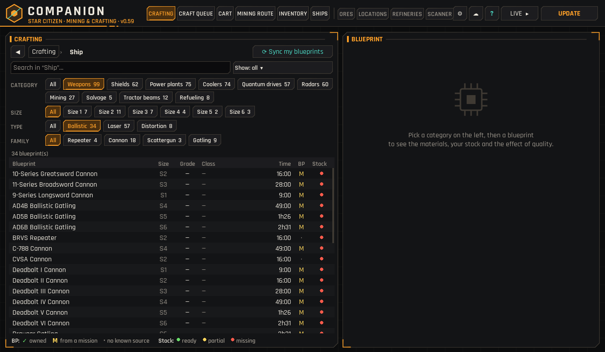
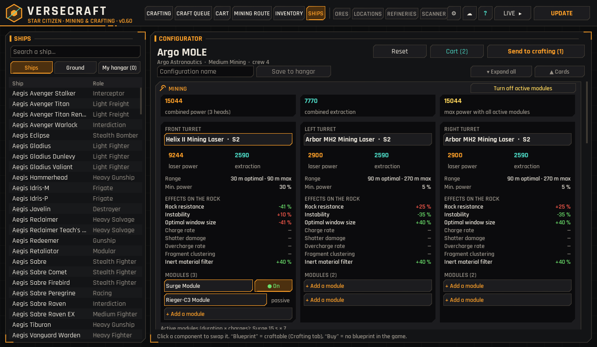
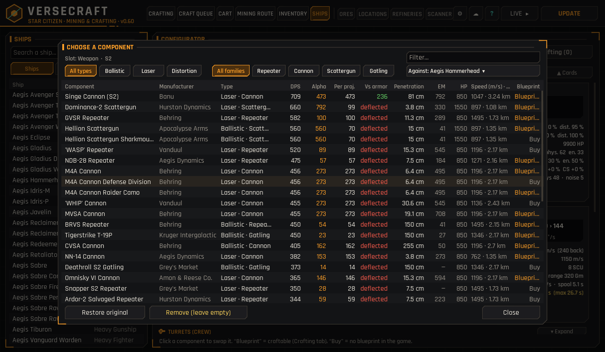
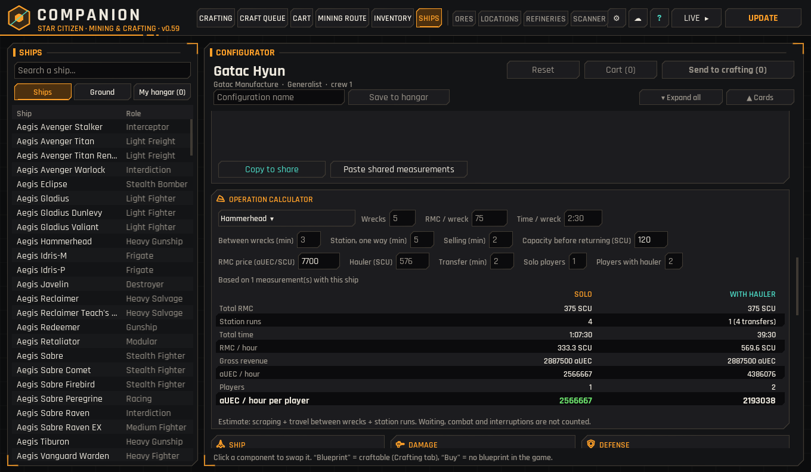

# Versecraft

**A Star Citizen companion app, focused on crafting.** Windows · English / français · free
Coded and maintained by **Viperhill**. *Formerly SC Companion.*

👉 **[Download the latest version](../../releases/latest)**

*[Version française plus bas](#français)*

---

### ✨ New in v0.59
Crafting filters · mining ship cards and a rock simulator · salvage tools with shareable measurements and an operation calculator · weapon alpha, penetration and armor check · near-instant start-up.

  
  
  
  

## What it does

- **Crafting**: pick a blueprint, set your target qualities, and the app tells you exactly which materials you are missing, and which missions give that blueprint.
- **Craft queue**: your projects grouped by ship or setup, with the shopping list of materials.
- **Mining route**: the fewest stops to get what you are missing, with the real chance of finding each ore and the signatures to look for on the scanner.
- **Ships**: a configurator (components, crafting qualities, pip-based power management, sustained DPS, shields, signatures, quantum range). Weapons with alpha, penetration and armor check against a target ship. Send your setup to crafting in one click.
- **Mining and salvage ships**: heads and modules with their stats, a rock simulator, salvage measurements you can share with the community, and an operation calculator (RMC and aUEC per hour).
- **Cart**: what can't be crafted, and where to buy it (UEX community prices, route, total).
- **Inventory and refining**: by hand or from screenshots of the freight manager and the refinery. Your owned blueprints are ticked automatically while you play.
- **Live signature scanner**: the app reads the number shown by the mining scanner and tells you which rock it is ("7 080 → 2 × Beryl"), in the app or in an overlay on top of the game. Rocks with an ore you need are marked ★. Game in Borderless mode.

The data is read **straight from your installed game files**: the app is up to date with every patch, and it never modifies the game.

## Install

1. Download `Versecraft-vX.XX.zip` from [Releases](../../releases).
2. "Extract all" wherever you like (Desktop, `C:\Games`…). Avoid `Program Files`: the app keeps your data next to it, in `data`.
3. Run `Versecraft.exe`, then click **UPDATE** at the top right. Do it again after every game patch.

Windows may show a SmartScreen warning the first time (the exe is not signed yet): "More info" → "Run anyway".

The full guide is inside the app: **?** button or **F1**. The app starts in English; switch to French with the **⚙** button.

## Updating

**New version of the app** — the app tells you when one is out.
1. Download the new `Versecraft-vX.XX.zip` from [Releases](../../releases) and "Extract all" to a temporary folder.
2. Close Versecraft.
3. Copy all the extracted files into your current app folder and choose "Replace the files in the destination".
4. Run `Versecraft.exe`: the new version shows at the top left. Coming from SC Companion (the old name)? Delete the old `SCCompanion.exe`: your data is kept.
5. Click **UPDATE** once.

⚠️ Never delete the `data` folder: it holds your inventory, queue, blueprints, hangar and settings (language, folders). The zip doesn't contain one, so it is never overwritten. To be safe, you can copy it first.

**After a game patch**: no new app version needed. Click **UPDATE** (or F5).

## More

- [Overview](DEVELOPMENT.md): features, requirements, version history ([version française](DEVELOPPEMENT.md)).
- [Licence](LICENCE.txt): free for personal use, all rights reserved.
- Support the project: ☕ https://buymeacoffee.com/viperhill

### 🎯 Funding goal

**Goal 1 — Sign the app (US$10 / month).** A code signing certificate removes the "Windows protected your PC" warning when you download and run Versecraft. Every coffee goes straight to it. Thank you!

Credits: [UEX](https://uexcorp.space) community prices, Aaron Halo bands by CaptSheppard.

---

## Français

**Une app compagnon pour Star Citizen, centrée sur le crafting.** Windows · gratuit · codée et entretenue par **Viperhill**. *Anciennement SC Companion.*

👉 **[Télécharger la dernière version](../../releases/latest)**

### ✨ Nouveau dans la v0.59
Filtres du crafting · fiches des vaisseaux de minage et simulateur de roche · outils de récupération avec mesures à partager et calculateur d'opération · alpha, pénétration et test du blindage des armes · ouverture presque instantanée.

### Ce qu'elle fait

- **Crafting** : choisis un plan, règle les qualités visées, et l'app te dit exactement quels matériaux il te manque, et quelles missions donnent ce plan.
- **File de craft** : tes projets groupés par vaisseau ou par setup, avec la liste de courses des matériaux.
- **Route de minage** : le moins d'arrêts possible pour aller chercher ce qui manque, avec la vraie chance de trouver chaque minerai et les signatures à repérer au scanner.
- **Vaisseaux** : un configurateur (composants, qualités de fabrication, gestion d'énergie par pastilles, DPS soutenu, bouclier, signatures, portée quantique). Armes avec alpha, pénétration et test du blindage d'un vaisseau cible. Envoie ton setup au crafting en un clic.
- **Vaisseaux de minage et de récupération** : têtes et modules avec leurs stats, un simulateur de roche, des mesures de récupération à partager avec la communauté, et un calculateur d'opération (RMC et aUEC à l'heure).
- **Panier** : ce qui ne se fabrique pas, et où l'acheter (prix de la communauté UEX, itinéraire, total).
- **Inventaire et raffinage** : à la main ou par captures d'écran du gestionnaire de fret et de la raffinerie. Tes plans possédés sont cochés tout seuls pendant que tu joues.
- **Scanner de signatures en direct** : l'app lit le nombre affiché par le scanner de minage et te dit quelle roche c'est (« 7 080 → 2 × Beryl »), dans l'app ou dans un overlay au-dessus du jeu. Les roches qui contiennent un minerai dont tu as besoin sont marquées ★. Jeu en mode Borderless.

Les données sont lues **directement dans les fichiers du jeu installé** : l'app est à jour à chaque patch, et elle ne modifie jamais le jeu.

### Installer

1. Télécharge `Versecraft-vX.XX.zip` dans les [Releases](../../releases).
2. Fais « Extraire tout » où tu veux (Bureau, `C:\Jeux`…). Évite `Program Files` : l'app garde tes données à côté d'elle, dans `data`.
3. Lance `Versecraft.exe`, puis clique **UPDATE** (**METTRE À JOUR** en français) en haut à droite. Refais-le après chaque patch du jeu.

Windows peut afficher un avertissement SmartScreen au premier lancement (l'exe n'est pas encore signé) : « Informations complémentaires » → « Exécuter quand même ».

L'app démarre en anglais : passe-la en français avec le bouton **⚙**. Le guide complet est dans l'app : bouton **?** ou touche **F1**.

### Mettre à jour

**Nouvelle version de l'app** — l'app t'avertit quand il y en a une.
1. Télécharge le nouveau `Versecraft-vX.XX.zip` dans les [Releases](../../releases) et fais « Extraire tout » dans un dossier temporaire.
2. Ferme Versecraft.
3. Copie tous les fichiers extraits dans ton dossier actuel de l'app et choisis « Remplacer les fichiers dans la destination ».
4. Lance `Versecraft.exe` : la nouvelle version s'affiche en haut à gauche. Tu viens de SC Companion (l'ancien nom) ? Supprime l'ancien `SCCompanion.exe` : tes données sont gardées.
5. Clique **METTRE À JOUR** une fois.

⚠️ Ne supprime jamais le dossier `data` : il contient ton inventaire, ta file, tes plans, ton hangar et tes réglages (langue, dossiers). Le zip n'en contient pas, il n'est donc jamais écrasé. Par prudence, tu peux en faire une copie avant.

**Après un patch du jeu** : pas besoin de nouvelle version de l'app. Clique **METTRE À JOUR** (ou F5).

### Plus d'infos

- [Présentation](DEVELOPPEMENT.md) ([English](DEVELOPMENT.md)) : fonctionnalités, configuration requise, historique des versions.
- [Licence](LICENCE.txt) : gratuit pour un usage personnel, tous droits réservés.
- Soutenir le projet : ☕ https://buymeacoffee.com/viperhill

**🎯 Objectif 1 — Signer l'app (10 $ US / mois).** Un certificat de signature de code enlève l'avertissement « Windows a protégé votre ordinateur » quand tu télécharges et lances Versecraft. Chaque café va directement là. Merci !

---

*Star Citizen is a trademark of Cloud Imperium Rights LLC. Versecraft is an unofficial fan tool, not affiliated with Cloud Imperium Games. · Star Citizen est une marque de Cloud Imperium Rights LLC. Versecraft est un outil de fan non officiel, sans lien avec Cloud Imperium Games.*
